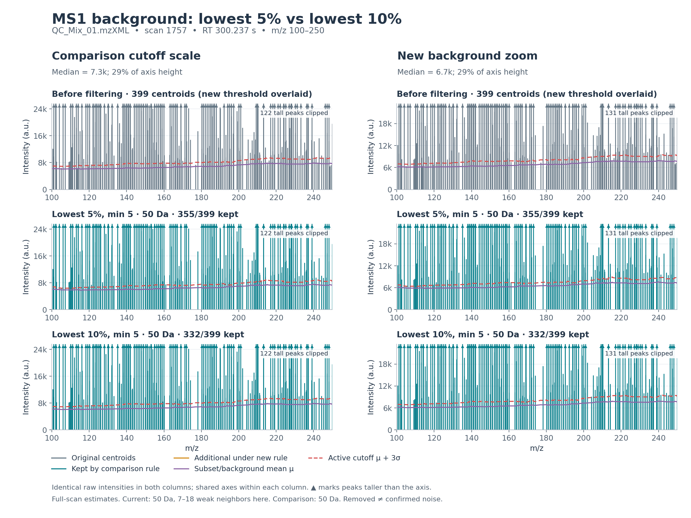
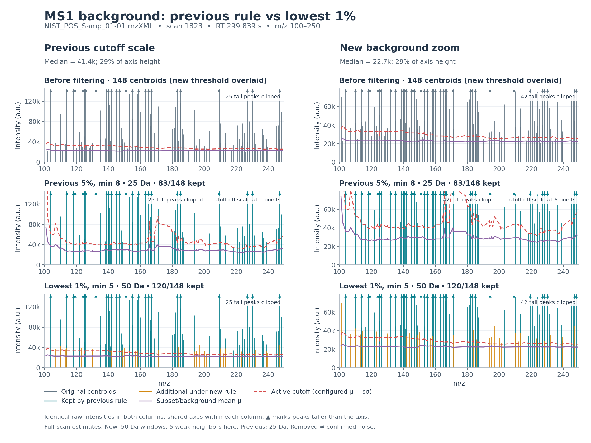
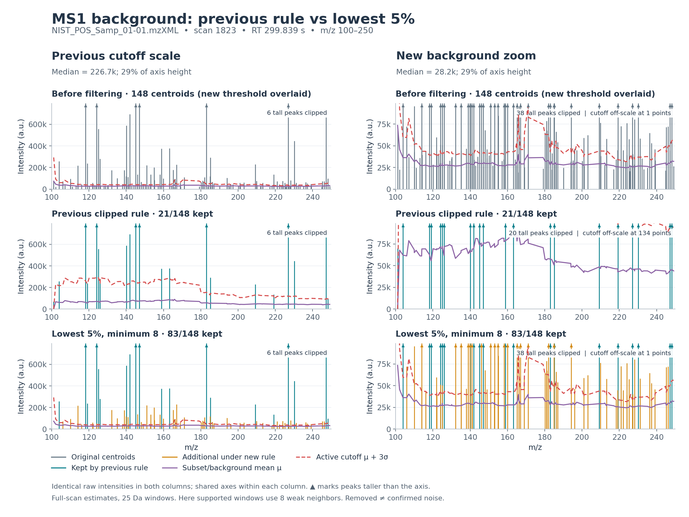

# Adaptive MS1 filtering examples

## Current 0.3.2: lowest 10%, always μ + 3σ

The defaults are **50 Da total (±25 Da), lowest 10%, minimum 5 neighbors**.
For `C` positive neighbors, excluding the candidate, select the weakest
`max(5, ceil(0.10 * C))` and calculate their mean and population standard deviation.
Retain centroids above `max(min_intensity, μ + 3σ)`. Windows with fewer than five
references use the configured floor. **The detection multiplier is fixed at 3**:
non-3 values in the API, JSON configuration or CLI are rejected.

The comparison below changes **only the fraction, 5% versus 10%**. The width,
minimum count, multiplier and intensity floor are identical. Each selected scan
is the acquisition midpoint of its file; thresholds use the complete scan,
then the plots show the same fixed m/z 100–250 region. All inputs are centroid exports.



| File / scan | Input centroids in detail window | Retained at 5% | Retained at 10% | Intensity retained at 5% | Intensity retained at 10% |
| --- | ---: | ---: | ---: | ---: | ---: |
| NIST_POS_Samp_01-01 / 1823 | 148 | 120 | 120 | 96.9% | 96.9% |
| Blank_00 / 1798 | 300 | 275 | 254 | 99.1% | 98.1% |
| QC_Mix_01 / 1757 | 399 | 355 | 332 | 99.0% | 98.4% |

The QC region has 65–173 eligible neighbors, so the 10% estimate uses 7–18
references. The sample region has 26–62 neighbors and uses 5–7; the two
fractions change its thresholds slightly but retain the same 120 centroids.
Across the whole sample scan, 10% retains 382/497 versus 389/497 at 5%.
The minimum count therefore still matters, especially on sparse centroid scans.

Purple is the selected-subset mean and dashed red is the threshold. The right
column places the median current background at **28.6% of the y-axis height**;
the left column does the same for the comparison cutoff. Axes are shared within
each column. Triangles mark peaks taller than the plotted range; actual values
and intensity totals are unchanged. These are filtering comparisons, not
labeled electronic-noise or analyte-recovery experiments.

Detailed outputs:

- **Sample:** [figure](v0.3.2/ms1_noise_comparison.png), [PDF](v0.3.2/ms1_noise_comparison.pdf), [full scan](v0.3.2/ms1_noise_full_scan.png), [per-centroid values](v0.3.2/ms1_noise_scan.tsv), [metadata](v0.3.2/ms1_noise_example.json).
- **Blank:** [figure](v0.3.2/blank/ms1_noise_comparison.png), [PDF](v0.3.2/blank/ms1_noise_comparison.pdf), [full scan](v0.3.2/blank/ms1_noise_full_scan.png), [per-centroid values](v0.3.2/blank/ms1_noise_scan.tsv), [metadata](v0.3.2/blank/ms1_noise_example.json).
- **QC:** [figure](v0.3.2/qc/ms1_noise_comparison.png), [PDF](v0.3.2/qc/ms1_noise_comparison.pdf), [full scan](v0.3.2/qc/ms1_noise_full_scan.png), [per-centroid values](v0.3.2/qc/ms1_noise_scan.tsv), [metadata](v0.3.2/qc/ms1_noise_example.json).

The [combined comparison report](../results/noise-fractions-v0.3.2.json)
records settings, counts, source checksums and the implementation fingerprint.

```bash
python benchmarks/plot_noise_estimators.py
python benchmarks/plot_noise_estimators.py validation/MSV000086989/Blank_00.mzXML \
  --out-dir benchmarks/figures/v0.3.2/blank
python benchmarks/plot_noise_estimators.py validation/MSV000086989/QC_Mix_01.mzXML \
  --out-dir benchmarks/figures/v0.3.2/qc
```

Earlier figures and exploratory parameter reports are retained as history.
Comparisons using multipliers other than 3 do not describe current processing options. The old 2σ plot script calculates
that illustrative threshold directly from returned background moments;
production processing always uses 3σ.

## Historical 0.3.1: 50 Da, lowest 1%, minimum 5

The default window is now **50 Da total (±25 Da)**. For `C` eligible positive
neighbors, excluding the candidate, choose `max(5, ceil(0.01 * C))` lowest
intensities, then apply their **mean + 3 population standard deviations**.
Fewer than 5 eligible neighbors use the configured floor (zero by default).
The algorithm is unchanged; the defaults replace 0.3.0's 25 Da / 5% / minimum 8.



This is the same native scan **1823**, RT **299.839 s**, m/z **100–250** from
`NIST_POS_Samp_01-01.mzXML`. Both estimates use the full scan before plotting.
The middle row uses the previous 0.3.0 defaults; the bottom uses the new
0.3.1 defaults. Purple is the background mean and dashed red is the threshold.
Teal peaks also passed the previous rule; orange peaks are newly retained.

| Scope | Previous retained | Current retained | Previous summed intensity retained | Current summed intensity retained |
| --- | ---: | ---: | ---: | ---: |
| m/z 100–250 | 83 / 148 | 120 / 148 | 91.2% | 96.9% |
| Entire scan | 310 / 497 | 389 / 497 | 93.8% | 96.8% |

The new median background is **22,658**, placed at **28.6%** of the right-hand
y-axis. The new median threshold is **27,783**. The left column places the
previous median cutoff (41,374) at 28.6% of that axis. Axes are shared within
each column; triangles indicate peaks extending above the displayed range.

All 148 displayed windows have 26–62 eligible neighbors and therefore use the
minimum of **5**, an effective fraction of **8.1–19.2%**. Across the entire
scan, 473 windows have support and 24 use the zero-floor fallback. The broader
window can provide support where the old window had none: overall it adds 115
centroids and loses 36 old retained centroids, net +79. The methods are not
necessarily nested. These retention counts do not identify true analytes or
true electronic noise; the low-subset sigma is not a full-noise sigma.

Artifacts: [vector PDF](v0.3.1/ms1_noise_comparison.pdf),
[full-scan view](v0.3.1/ms1_noise_full_scan.png),
[per-centroid values](v0.3.1/ms1_noise_scan.tsv), and
[configuration and checksums](v0.3.1/ms1_noise_example.json).

Reproduce the historical 0.3.1 comparison:

```bash
python benchmarks/plot_noise_estimators.py --comparison previous-defaults \
  --noise-fraction 0.01 --noise-window-da 50 --noise-min-neighbors 5 \
  --out-dir validation/reproduce_v031
```

The script takes its defaults from `Config`; `--comparison clipped` instead
selects the historical 0.2.0 estimator with its original 25 Da / minimum 8 settings.
Previous figures and their metadata remain below, unchanged.

## Historical 0.3.0: clipped versus low-tail

Version 0.3.0 uses the **lowest-intensity 5% of positive neighbors, expanded to
at least 8**, then applies **the selected subset's mean + 3 standard deviations**.
The previous two-pass clipped estimator is retained as `--noise-estimator clipped`.

The comparison uses the same input and selection as the previous figure:
`NIST_POS_Samp_01-01.mzXML`, MSV000086989, native scan **1823**, RT **299.839 s**,
m/z **100–250**. The scan is chosen by nearest acquisition-time midpoint,
independently of either filtering outcome. Both estimators use the **complete
scan**, a 25 Da window, exclusion of the candidate, minimum 8 references, and
no absolute intensity floor. The input is already centroided.



Rows show unfiltered centroids, the previous clipped rule, and the new low-tail
rule. The first row overlays the new background/cutoff; the other rows show
their own estimates. Original centroid heights are preserved.

The left column places the previous median cutoff (226,734) at **28.6%** of its
linear y-axis. The right column places the new median background (28,221) at
**28.6%** of its y-axis; the new median cutoff is 41,374. Axes are shared within
each column. Purple is background mean, red dashed is the detection threshold,
teal is retained by the previous rule, and orange is additionally retained by
the new rule. Triangles mark tall peaks; their intensities remain unchanged in
the data and totals. Off-axis cutoff points are explicitly counted.

| Scope | Previous centroids retained | New centroids retained | Previous summed intensity retained | New summed intensity retained |
| --- | ---: | ---: | ---: | ---: |
| m/z 100–250 | 21 / 148 (14.2%) | 83 / 148 (56.1%) | 68.5% | 91.2% |
| Entire scan | 129 / 497 (26.0%) | 310 / 497 (62.4%) | 76.3% | 93.8% |

The new rule adds 63 centroids and loses one previously retained centroid in
the displayed window (net +62). The rules are not necessarily nested: legacy
clipping can leave too few references and trigger its zero-floor fallback,
whereas the new rule can still have eight references and a positive threshold.

**The minimum count dominates this example.** Each displayed point has only
8–32 eligible neighbors, so all 148 estimates use the weakest **8**. That is
25–100% of available neighbors, not literally 5%. Across the full scan, 425
supported points use 8 references and 72 unsupported points use the zero floor.
The effective fraction is recorded for audit; the window is never widened to
force a minimum count. With 181 eligible neighbors the same algorithm would
use the lowest 10 (the ceiling of 5%).

The standard deviation of a lowest-intensity subset is not the standard
deviation of the whole noise distribution. The new rule is more permissive
here and can retain background as well as real weak ions. In the uniform
synthetic noise fixture it retains over 80% of points; extra peaks and larger
feature counts are not validated analytes. Removed centroids also lack
truth labels. One scan cannot establish chromatographic coherence or identity.

Artifacts: [vector PDF](v0.3.0/ms1_noise_comparison.pdf),
[full-scan view](v0.3.0/ms1_noise_full_scan.png),
[all per-centroid values and selected counts](v0.3.0/ms1_noise_scan.tsv), and
[configuration, checksums and totals](v0.3.0/ms1_noise_example.json).
The [previous 0.2.0 comparison of 3σ and 2σ](v0.2.0/README.md) is archived separately.

Reproduce from the repository root after downloading the validation sample:

```bash
python -m pip install matplotlib
python benchmarks/plot_noise_estimators.py --comparison clipped \
  --noise-window-da 25 --noise-fraction 0.05 --noise-min-neighbors 8 \
  --out-dir validation/reproduce_v030
```

For another scan or a different minimum count:

```bash
python benchmarks/plot_noise_estimators.py \
  validation/MSV000086989/NIST_POS_Samp_01-01.mzXML \
  --rt-seconds 450 --mz-min 250 --mz-max 400 \
  --noise-fraction 0.05 --noise-min-neighbors 5 --comparison clipped \
  --out-dir validation/noise_example_450s
```

To reproduce the earlier estimator diagnostic, run `python benchmarks/plot_ms1_noise.py`;
that script is explicitly pinned to `clipped` and writes to `benchmarks/figures/legacy_clipped/`.
Matplotlib is a diagnostic dependency only. For exact algorithms, see
[Methods §3](../../docs/METHODS.md#3-new-ms1-algorithm-moving-low-intensity-background-across-mz).
