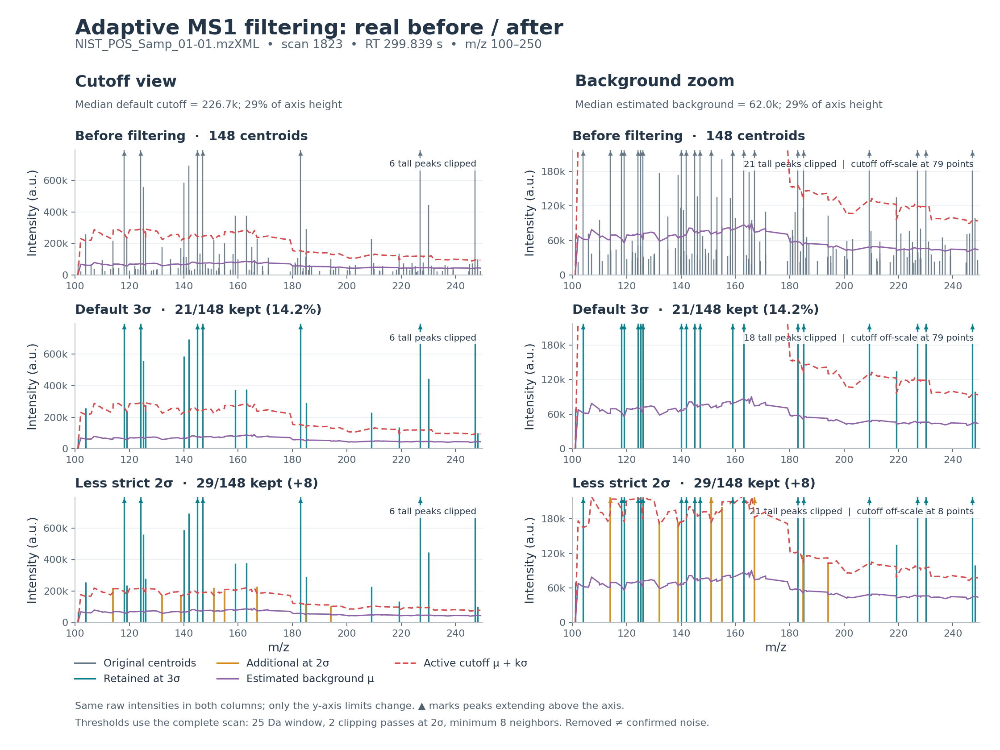

# Historical 0.2.0 clipped-filter example

The input is `NIST_POS_Samp_01-01.mzXML` from the downloaded MSV000086989
validation sample. Selection is fixed independently of the filtering outcome:
use the MS1 nearest the midpoint of acquisition time and inspect m/z 100–250.
This gives native scan **1823**, RT **299.839 seconds**. The source is already
centroided; these are spectral centroids, not completed chromatographic features.



Rows show the input, the then-current `mean + 3 × std` cutoff, and a comparison
using `mean + 2 × std`. Only the detection multiplier changes. Background
estimation still uses a 25 Da window, two clipping passes at 2 standard
deviations, at least eight neighbors, and no absolute intensity floor.
Both curves are computed from the **complete scan**, before cropping the plot.

The two columns display exactly the same intensities on different linear axes:

- **Cutoff view:** the median default cutoff, 226,734, is 28.6% of the axis height.
- **Background zoom:** the median estimated background, 62,005, is 28.6% of the
  axis height. The default cutoff exceeds this tighter axis at some masses;
  those portions are off-scale and explicitly counted in each panel.

Triangles mark peaks taller than the visible axis. Display clipping does not
modify their values or the statistics below. Purple is the estimated background,
red is the active cutoff, teal marks centroids retained at the default, and
orange marks the additional centroids retained at the lower cutoff.

| Scope / setting | Centroids retained | Original summed centroid intensity retained |
| --- | ---: | ---: |
| m/z 100–250, default 3σ | 21 / 148 (14.2%) | 68.5% |
| m/z 100–250, comparison 2σ | 29 / 148 (19.6%) | 74.7% |
| Entire scan, default 3σ | 129 / 497 (26.0%) | 76.3% |
| Entire scan, comparison 2σ | 148 / 497 (29.8%) | 79.4% |

The default removes 127 centroids and 31.5% of summed intensity in the displayed
window. The comparison recovers eight centroids. Removed points are **not
ground-truth electronic-noise labels**: real weak ions may also be removed.
One scan cannot establish chromatographic coherence or analyte identity.
This is a diagnostic comparison; processing defaults were not changed.

For context, [the full-scan figure](ms1_noise_full_scan.png) includes the sparse
high-mass regions. Seventy-three centroids have a zero cutoff because too few
background neighbors remain; these are kept under the configured sparse-window
fallback. The chosen detailed window has one such centroid.

Artifacts: [vector PDF](ms1_noise_before_after.pdf),
[all per-centroid values](ms1_noise_scan.tsv), and
[scan/configuration/checksum metadata](ms1_noise_example.json).
The metadata also identifies the numerical implementation used.

Reproduce from the repository root after downloading the validation corpus:

```bash
python -m pip install matplotlib
python benchmarks/plot_ms1_noise.py
```

To inspect another time/range, for example:

```bash
python benchmarks/plot_ms1_noise.py \
  validation/MSV000086989/NIST_POS_Samp_01-01.mzXML \
  --rt-seconds 450 --mz-min 250 --mz-max 400 \
  --out-dir validation/noise_example_450s
```

Matplotlib is used only by this diagnostic script, not by the processing runtime.
