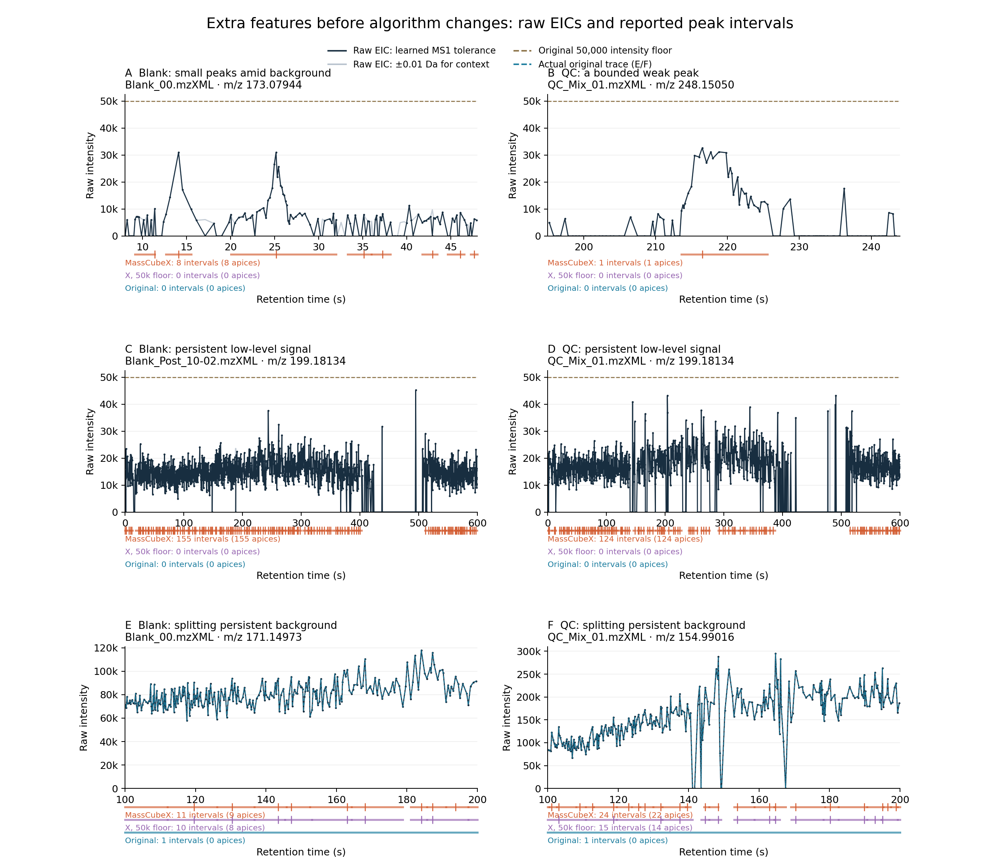

# Blank/QC EIC review and the v0.10 changes

The extra v0.9 features include plausible weak chromatographic peaks, persistent
background, and excessive splitting of that background. **They cannot all be
interpreted as improved sensitivity.** Fixed 100 Da noise bins do not solve the
splitting problem. This release changes regional noise estimation and MS2-seed
gap filling; the detected-feature tracking and segmentation algorithms remain
unchanged pending review of the evidence below.

## Data and comparison

All six blanks and four QC files in the existing 50-file MSV000086989 download
were screened. Input names and SHA-256 values are in the validation manifest and
[50-file report](MSV000086989-ms2-v0.10.0.json). Original MassCube is the untouched
1.2.22 source at `356748ede691862b9a87f67812db5e728a703b9d`. Its mzXML metadata
adapter, Orbitrap defaults and feature-count conventions are documented in
[OUTPUT_AND_COUNTS.md](OUTPUT_AND_COUNTS.md). The original MS1 floor is 50,000.

The plots use **archived v0.9 detections before these changes**, with unrounded
coordinates from the numerically identical v0.8 tables. Raw EICs are independently
decoded by Pyteomics, without adaptive filtering or baseline subtraction. They
take the maximum centroid intensity per MS1 scan in a fixed mass interval.
Black uses the learned MS1 radius; gray uses ±0.01 Da as wider mass context.
The gray curve is a reconstructed raw EIC, not MassCube's internal tracked trace.
Actual reported feature bounds/apices are overlaid below each plot:

- Orange: MassCubeX v0.9 defaults.
- Purple: MassCubeX with only the MS1 noise rule replaced by a 50,000 floor.
- Blue: original MassCube, including its short single-file rows.

Bars show integration intervals, ticks show apices. A long original interval
may cross the displayed region while its apex lies elsewhere. Counts here are
output intervals near a chosen mass, **not molecule counts or a formal one-to-one
cross-tool match**. Different mass estimators, tracing tolerances, gap rules and
peak boundaries limit such matching.



[Full-resolution PDF](../figures/eic-review-v0.9/eic_comparison.pdf) ·
[Exact plotting coordinates, radii and counts](../figures/eic-review-v0.9/eic_comparison.json)

## What the examples establish

| Case | Observation | Interpretation |
| --- | --- | --- |
| Blank_00, m/z 173.07944, 8–48 s | Small peaks around 14/25 s, height ≈31k, amid fluctuating low signal; X reports eight intervals, original none in this region | Some peak-like structure is recovered, but several nearby intervals look like background |
| QC_Mix_01, m/z 248.15050, 195–244 s | A bounded peak around 216–225 s, height 32,639; X reports one interval, original none in this region | Plausible weak peak lost to the original 50k floor |
| Blank_Post_10-02, m/z 199.18134, full run | Mostly persistent signal around 10–20k, divided into 155 X features; original zero | Strong evidence of background being reported as many peaks |
| QC_Mix_01, m/z 199.18134, full run | Similar persistent signal, divided into 124 X features; original zero | The problem recurs in QC, not just one blank |
| Blank_00, m/z 171.14973, 100–200 s | Persistent signal above 50k; 11 X intervals, 10 with the 50k control, one original interval | Splitting persists even with the original absolute floor |
| QC_Mix_01, m/z 154.99016, 100–200 s | Fluctuating elevated baseline; 24 X intervals, 15 with the 50k control, one original interval | Additional chromatographic splitting is a separate contributor |

EIC shape alone cannot prove chemical identity, distinguish all chemical
background from electronic noise, or establish a false-discovery rate. A bounded
peak in a blank can be contamination or carryover. These are diagnostic examples,
not a random labelled truth set.

The weak-candidate screen required height 10k–48k, ≥10 observed scans, a 2–40 s
reported interval, apex 20–580 s, no original apex within ±0.01 Da and the
interval ±2 s, and raw peak height ≥4× the 75th-percentile flank intensity.
Flanks extended 2–15 s outside the interval. There were 2,658 candidates across
the ten files; this is **not** a count of validated real peaks. Candidates were
ranked by observed scan count, then peak/flank ratio. Representative examples
were selected to show both peak-like signals and failure modes. Persistent
signals were identified by unusually many output intervals at a common mass.

The original segmentation code skips splitting when its chromatographic
noise score exceeds 3 and requires candidate maxima above the trace median.
For the actual upstream traces in panels E and F, the pre-segmentation scores
are **59.73** and **29.63**, so upstream explicitly skips segmentation in both.
These are original internal traces, exported by rerunning the pinned upstream
source and verifying its final masses/apices against the archived tables;
the dashed blue curves show them. [Trace samples and gate values](../figures/eic-review-v0.9/upstream_traces.json).

MassCubeX does not currently apply those gates. Its noise filter, tracking and
time-based segmentation also differ. The equal-floor control establishes that
noise filtering alone does not explain all excess rows; it does not isolate
every remaining cause.

## Fixed 100 Da bins: approved change, not a stronger filter

Per MS1 scan, bins are `[0,100)`, `[100,200)`, etc., anchored at zero. Select the
lowest `max(5, ceil(0.10 × N))` positive intensities in each bin and compute
`μ + 3σ` from that same subset (`ddof=0`). Every point in a bin shares that
threshold. With fewer than five positive samples, use the explicit floor alone.
This replaces the former per-point, leave-one-out ±25 Da sliding window.

| Group | Original MS1 rows with ≥5 observations | X v0.9 detected | X v0.10 detected |
| --- | ---: | ---: | ---: |
| Six blanks | 14,283 | 281,156 | 284,762 |
| Four QC | 11,290 | 184,508 | 186,340 |
| Forty biological samples | 365,615 | 1,069,805 | 1,079,367 |
| Total | 391,188 | 1,535,469 | 1,550,469 |

The new bins yield **0.98% more detected features**, not fewer. Wider/fixed bins
can raise or lower a local threshold, and a low-tail σ does not represent the
spread of the whole background distribution. The old 50,000-floor control gave
46,462 blank and 35,509 QC detections; disabling splitting in that control gave
13,773 and 10,524. Neither control has been adopted as the new algorithm.

The next controlled experiment should assess local chromatographic background,
rise/fall support and valley depth, with explicit preservation of the bounded
weak QC peak above. Reintroducing or adapting the original noise-score gate
should be evaluated as an ablation, not assumed to be the optimal rule.

## What `ambiguous_mass` actually meant, and the defect found

In v0.9 the gap filler searched broadly, constructed several narrow EICs, and
compared their **maximum MS1 intensity near the MS2 time**. If the two highest
were 100 and 80, `100 / 80 = 1.25 < 3` caused `ambiguous_mass` and missing MS1
quantification. It was an intensity-dominance heuristic, not mass uncertainty.

Worse, candidate windows could overlap and count the same raw centroid twice.
All 64 historical ambiguous rows in the six blanks/four QC were independently
reconstructed. **56/64 (87.5%) selected the identical raw centroid as both
competitors' maximum.** This directly demonstrates duplicate evidence in those
cases; it does not classify the other eight as distinct chemical ions.

Concrete example: Blank_00 feature 34384, precursor **213.14984725**, MS2 time
**213.37 s**. Candidate centers were 213.15034485 and 213.14899445. Both selected
the same raw centroid at **213.14959717**, intensity **160,707.09**. The ratio
was therefore 1, and the old rule incorrectly labelled competing masses.
The complete [raw-evidence audit](gapfill-ambiguity-v0.9.json) records all cases.
In v0.10 the same MS2 scan (1275) maps to seeded feature 34634, with measured
height 160,707.09, area 526,435.64, and status `gap_filled`.

## Strict gap filling and missing-height imputation

The nominal narrow gap-fill radius already equalled the learned MS1 tolerance,
but v0.9 first allowed a **±max(0.05 Da, 100 ppm)** recentering search. That broader
eligibility is now removed. Both refined and fallback modes query one EIC
anchored at the original precursor m/z, with radius:

```text
min(max(MS1_Da, m/z × MS1_ppm × 1e-6),
    max(gapfill_Da, m/z × gapfill_ppm × 1e-6))
```

Thus an explicit gap-fill setting can narrow the window but cannot widen it
beyond ordinary MS1 matching. The 3× candidate-ranking rule is removed;
`ambiguous_mass` is no longer emitted. This is an operational EIC association,
not deconvolution of coisolated ions.

| File | Learned MS1 and default gap-fill radius |
| --- | --- |
| Blank_00 | ±max(0.0009475708 Da, 5 ppm) |
| QC_Mix_01 | ±max(0.0009375000 Da, 5 ppm) |
| NIST_POS_Samp_01-01 | ±max(0.0007583618 Da, 5 ppm) |
| No supported calibration | ±max(0.002 Da, 10 ppm) |

At m/z 213.15 in Blank_00, the radius is approximately **0.001066 Da**.
Refined local RT boundaries and the fallback ±5 s time window are unchanged.

An actual MS1 ion, even below the adaptive threshold, retains its measured raw
height and area. Only absent local MS1 signal receives an imputed height:

- Take up to the three closest compatible MS1 scans inside the query time window.
- Calculate the threshold in the precursor's m/z bin in each scan; use the median
  of the positive supported thresholds (an explicit positive floor also counts).
- Set `peak_height = 0.1 × threshold`, `peak_area = null`, `scan_count = 0`, and
  `ms1_quant_status = imputed_noise`. Preserve the absence reason in `gapfill_status`.
- Record the reference in `apex_noise_threshold`; the row has no measured apex
  or manufactured grouping trace. Keep every associated MS2 identifier.

Missing scans, ambiguous polarity, unsupported noise, local-bound mismatch and
sampling limits remain unquantified. Setting `--gapfill-noise-fraction 0` disables
imputation. Values are rounded only when writing the existing compact schema.
For example, QC_Mix_01 feature 41777 (m/z 803.54358) has no local MS1 signal:
reference threshold 84,050.27, imputed height 8,405.03, missing area, zero scans,
and status `imputed_noise`. Its MS2 references remain intact.

## Validation and reproduction

The 50-file run produces **1,555,304 rows**: 1,550,469 detected and 4,835 seeded.
All **125,266 MS2 scans** are assigned exactly once. Of the seeded rows, **4,653**
have independently verified raw MS1 measurements and **121** have independently
verified imputed heights with missing area. Sixty have `no_local_peak`; one has
`no_local_ms1_signal` without a supported noise estimate.

Unit/integration tests cover bin boundaries and sparse bins, an independent
sorted-array noise reference, profile input, polarity switching, strict mass
bounds, below-threshold measurements, imputation, worker determinism, corrupt
files and source-fingerprint invalidation. See the release and parity reports
for the exact final test counts and implementation fingerprint.

**580 source and 580 installed-wheel tests pass; lint passes.** All 1,555,304
Parquet and TSV rows match. Replaying the old ±25 Da sliding noise setting on
all ten blank/QC files preserves **465,664 detected-feature measurements and
MS2 links exactly**, isolating the gap-fill changes from MS1 detection.
[Parity and replay report](eic-revision-v0.10.0.json) · [Release record](release-v0.10.0.json).

```bash
python benchmarks/audit_eics.py
python benchmarks/audit_gapfill_candidates.py
PYTHONPATH=validation/output-v0.9/upstream/src:validation/output-v0.9/upstream-deps \
  python benchmarks/export_upstream_eics.py
python benchmarks/plot_eic_review.py
python benchmarks/validate_ms2_coverage.py --workers 2
python benchmarks/validate_eic_revision.py
```

The diagnostics require archived v0.9/v0.8 tables and the original MassCube
comparison under `validation/`. Only `export_upstream_eics.py` reruns detection,
using untouched upstream code; none of these diagnostics changes algorithms.
Raw files and large feature tables remain local. Published plots, summaries,
input checksums and scripts make the selected examples reviewable.
