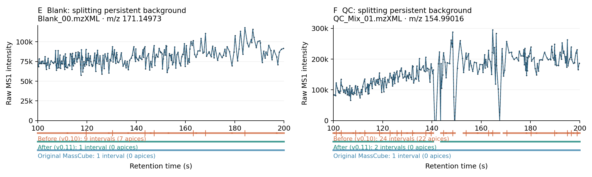
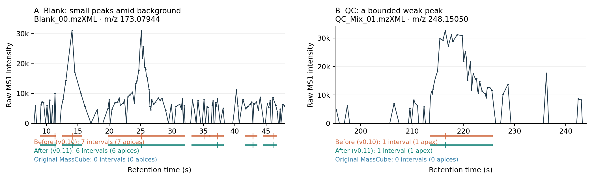

# Preventing background over-splitting — MassCubeX 0.11.0

MassCubeX now keeps poorly supported fluctuations in a continuous mass trace
from becoming many separate features. In the reviewed 100–200 s regions,
`Blank_00` m/z 171.14973 changes from **9 intervals to 1**, and `QC_Mix_01`
m/z 154.99016 from **24 to 2**. The bounded weak QC peak at m/z 248.15050
retains exactly the same mass, apex, boundaries, height, area and scan count.



Bars show intervals, ticks show apices **within the displayed window**. A broad
retained trace can have its apex outside this window; zero visible apices does
not mean the feature was deleted. The QC's remaining two intervals belong to
separately completed traces, with boundaries at 140.51 and 143.72 s. This change
does not bridge acquisition/mass-trace gaps or identify chemical contamination.

## What original MassCube actually does

At upstream commit `356748ede691862b9a87f67812db5e728a703b9d`,
[feature evaluation](https://github.com/Philipbear/masscube/blob/356748ede691862b9a87f67812db5e728a703b9d/src/masscube/feature_evaluation.py)
calculates an apex/FWHM Gaussian Pearson similarity. The
[splitter](https://github.com/Philipbear/masscube/blob/356748ede691862b9a87f67812db5e728a703b9d/src/masscube/feature_detection.py)
does **not** use Gaussian similarity as its splitting gate: it leaves a trace
unsplit when its total-variation noise score exceeds 3. Gaussian similarity
is subsequently used in alignment quality selection.

MassCubeX through 0.10 used Gaussian smoothing without those final shape scores
or the noise-score guard. This explains why a jagged but persistent trace could
produce numerous short intervals. The earlier [EIC audit](EIC_REVIEW.md) measured
original trace noise scores of 59.73 and 29.63 in the two examples above.

## Implemented rule

The [complete algorithm and equations](../../docs/METHODS.md#shape-guard-introduced-in-011)
are documented separately from the short README. The defaults are:

- Whole-trace MassCube noise score **above 3** activates the additional guard.
  Cleaner traces keep the previous segmentation behavior.
- Bridge short missing-scan runs for split detection only. Original samples,
  missing-scan zeros and integration times remain the quantitative inputs.
- Evaluate candidate peaks within fixed adjacent-valley basins. Require smoothed
  excess height at least **5× robust temporal noise**, at least five observed
  samples, and at least three observations above half the raw excess height,
  with evidence on both sides of the apex.
- Require Gaussian-template correlation **≥0.7** after local baseline removal.
  Either a symmetric or two-sided template can pass, so fronting/tailing peaks
  are not forced to be symmetric.
- Split only between supported candidates. With fewer than two, retain the
  original trace as one feature. Do not delete it for poor shape.

The temporal-noise estimate uses MAD of normalized local linear-prediction
residuals, with unequal scan spacing accounted for. It excludes missing-sample
triples. This is distinct from the **unchanged MS1 mass-axis μ + 3σ filter**.

A whole-trace cutoff alone is insufficient: five ideal separated peaks can have
noise score above 3. The candidate checks preserve these peaks in tests, including
10:1 tailing and different scan spacings, while suppressing persistent random
background, short dropouts and isolated spikes.

New output columns are `gaussian_similarity` (symmetric score on original data,
two decimals) and `segmentation_status`. In the blank example the retained
1.15–479.39 s feature has similarity **0.08** and status `guarded_unsplit`.
That records poor chromatographic shape without turning the trace into many
rows or losing its MS2 scans. Seeded forced measurements have null similarity
and `not_applicable`; they are not segmented by this guard.

Disable the change with `--no-peak-shape-guard`. Controls are
`--peak-noise-score-limit 3`, `--peak-min-snr 5` and
`--peak-min-gaussian-similarity 0.7`. These are explicit settings, not learned
from this dataset.

## Real-file results

Same 50 checksum-verified MSV000086989 files as the previous audit: six blanks,
four QCs and 40 biological files. Other processing settings remain unchanged.
The comparison below uses v0.10's fixed 100 Da noise bins for both runs.

| Group | Files | Detected rows before | Detected rows after | Reduction | Original MassCube, ≥5 scans |
| --- | ---: | ---: | ---: | ---: | ---: |
| Blanks | 6 | 284,762 | 75,146 | 73.6% | 14,283 |
| QCs | 4 | 186,340 | 57,625 | 69.1% | 11,290 |
| Biological | 40 | 1,079,367 | 610,654 | 43.4% | 365,615 |
| Total | 50 | 1,550,469 | 743,425 | 52.1% | 391,188 |

Original MassCube uses a 50,000 intensity floor and a broader mass tolerance;
its column is context, not an equal-sensitivity truth set. MassCubeX still has
more detected rows, particularly from weak/background signals below that floor
and separately completed traces. Fewer rows do not establish chemical accuracy.

The persistent m/z 199.18134 signal changes from **157 to 8** intervals in
`Blank_Post_10-02` and **124 to 20** in `QC_Mix_01`. Remaining rows include trace
interruptions and short traces that do not trigger the whole-trace guard.
This revision addresses excessive *within-trace splitting*, not all sources of
background features. The bounded weak-peak example at m/z 248.15050 is a
preservation control, not a measurement of overall peak-detection sensitivity.



See the [full six-panel figure](../figures/peak-shapes-v0.11/comparison.png),
[persistent-signal panels](../figures/peak-shapes-v0.11/persistent_signal.png),
[exact figure selections](../figures/peak-shapes-v0.11/comparison.json), and
[per-file results](peak-shapes-v0.11.0.json).

## Verification and performance

- **650 source tests and 650 isolated installed-wheel tests pass**, including
  the existing profile/mzML/mzXML, polarity switching, error continuation,
  grouping, scan provenance and gap-filling suites. Compiled segmentation is
  checked against an independent NumPy/SciPy implementation. Lint passes.
- The [independent raw-data audit](MSV000086989-ms2-v0.11.0.json) accounts for
  **all 125,266 MS2 scans exactly once**, including representative scan selection.
  It validates 4,152 raw seeded measurements and 121 noise-imputed heights.
  No MS2 is unassigned in this cohort. There are 4,320 seeded rows; 47 retain
  unavailable measurements for reported reasons.
- All **747,745** final rows agree between Parquet and TSV, including the new
  diagnostics. Default Parquet files total 31,716,294 bytes versus 53,127,862
  before, despite adding two diagnostic columns.
- Disabling the guard reproduces **all 27 previous output columns on all
  471,617 blank/QC rows exactly**, including MS2 lists and ion relations.
  This isolates the new splitting rule from unrelated processing changes.
- All 24 installed Python modules match the built wheel and source byte-for-byte;
  the wheel contains no generated Numba caches. See the [release record](release-v0.11.0.json).

On the same M2 Max, three warm serial passes of all 10 blank/QC files per setting,
with alternating order and unchanged v0.11 code, give the following median times:

| Processing stage, 10 files | Guard off | Guard on |
| --- | ---: | ---: |
| Calibration | 3.35 s | 3.38 s |
| MS1 extraction, including reading | 5.17 s | 4.01 s |
| MS2 association | 0.60 s | 0.23 s |
| Raw-MS1 gap filling | 0.77 s | 0.34 s |
| Ion grouping | 2.58 s | 0.73 s |
| Parquet writing | 3.70 s | 1.13 s |
| Complete processing | **16.29 s** | **9.85 s** |

Complete processing is **1.65× faster** in this blank/QC comparison, largely
because it creates fewer intervals and performs less downstream grouping and
writing. Scientific outputs differ; this is not a speedup of an equivalent
calculation. Per-stage medians need not sum to the median complete time.
A separate single warm default pass over all 50 files took **47.70 s**, excluding
independent auditing and table comparisons; it was not a repeated benchmark.

## Limits and reproduction

These are positive-mode centroid mzXML files from one cohort. Synthetic checks
cover other modes and formats, but do not establish their real-file performance.
There is no chemically labelled ground truth here. Weak, poorly sampled or
irregular real peaks in a noisy trace may remain combined; strongly structured
background can still resemble a peak. A low Gaussian score is a diagnostic,
not a contamination label, and a retained long trace's raw area includes its
background signal. No baseline correction or cross-file alignment was added.

After changing imported compiled helpers, clear generated `.nbc`/`.nbi` caches
before validation as described in [DEVELOPMENT.md](../../docs/DEVELOPMENT.md).
With the downloaded raw cohort and archived v0.10/upstream outputs available:

```bash
python benchmarks/validate_ms2_coverage.py --workers 4
python benchmarks/validate_peak_shapes.py
python benchmarks/plot_peak_shapes.py
pytest -q
ruff check src tests benchmarks
```

Input manifests, old comparisons, and original-MassCube adapter details are
linked in [OUTPUT_AND_COUNTS.md](OUTPUT_AND_COUNTS.md) and [EIC_REVIEW.md](EIC_REVIEW.md).
Do not run the serial timing script concurrently with tests or another benchmark.
